# Workload-Aware L1 Data Cache Performance Analysis Using gem5

<!-- main-result -->
## Main Result: Workload-Aware Cache Configuration (Q3)

A rule on measured features (L2 MPKI, branch MPKI) classifies a workload as compute-, memory-, or branch-intensive, and each class maps to a cache configuration selected from a 9-configuration gem5 sweep.

| Class | Recommended L1D + L2 | Capacity vs baseline (1328 KiB) | Worst workload in class |
|---|---|---:|---|
| compute | 32 KiB 8-way + 256 KiB 4-way | 288 KiB (-78%) | matmul_tiled, 0.975 |
| branch | 48 KiB 12-way + 512 KiB 8-way | 560 KiB (-58%) | qsort, 0.972 |
| memory | 16 KiB 4-way + 1280 KiB 10-way | 1296 KiB (-2%) | pchase, 0.999 |

Held-out validation: 4/4 classified correctly, 3/4 recommended configurations kept at least 95% of baseline performance. The failure (hashchain, 0.574x) shows that class alone does not determine cache need. 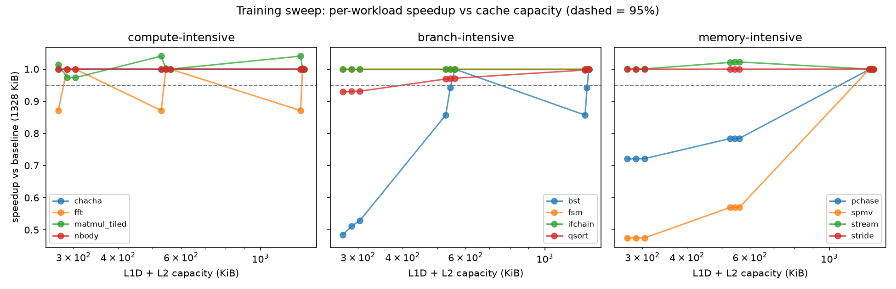

Full method, results, and limitations: [reports/workload_aware_recommendation_report.md](reports/workload_aware_recommendation_report.md). The earlier L1D-only study (3 workloads, TimingSimpleCPU, no L2) is described below as Phase 1.


## Overview (Phase 1: L1D-only study)

This project evaluates the effect of L1 data cache (L1D) size and associativity on simulated execution performance across three workloads using gem5.

The experiment evaluates four L1D cache capacities and three associativity levels while holding the L1 instruction cache (L1I) configuration fixed. The resulting 36 observations are compared using simulated ticks, CPU cycles, instructions per cycle (IPC), and L1D demand misses.

The project also extracts workload characteristics from gem5 statistics, generates workload feature summaries, assigns benchmark-defined workload categories, and produces cache configuration recommendations based on observed simulated execution time.

The results demonstrate that the observed sensitivity to L1D configuration differs by workload. These findings apply to the specific workloads and simulation configuration tested; they do not establish a universally optimal cache design.

## Objectives

- Evaluate four L1D cache sizes: 16, 32, 64, and 128 KiB.
- Evaluate 4-way, 8-way, and 16-way L1D associativity.
- Compare cache performance across three workloads.
- Examine the relationship between execution metrics and cache misses.
- Extract workload characteristics from gem5 statistics.
- Generate workload-level feature summaries.
- Assign benchmark-defined workload categories.
- Identify the fastest observed configuration for each workload.
- Generate workload-specific cache recommendations relative to a common baseline.

## Experimental Methodology

### Experimental Design

| Parameter | Configuration |
|---|---|
| Simulator | gem5 |
| CPU model | `X86TimingSimpleCPU` |
| Memory mode | Timing |
| CPU clock | 2 GHz |
| Configured memory | 512 MiB, DDR3-1600 |
| L1 instruction cache | 32 KiB, 8-way |
| L1 data cache sizes | 16, 32, 64, 128 KiB |
| L1 data cache associativity | 4-way, 8-way, 16-way |
| Workloads | 3 |
| Configurations per workload | 12 |
| Total observations | 36 |
| Execution mode | Syscall emulation |

The experiment evaluates the complete 4-by-3 L1D configuration grid for each workload. Other simulation parameters remain fixed according to the project's gem5 configuration.

The configured cache hierarchy contains L1 instruction and data caches connected to the system crossbar. No explicit L2 cache is configured in this experiment.

Recorded gem5 source version:

`v25.1.0.1-10-g38716b67fb`

### Workloads

#### 1. Matrix Multiplication

Source: `workloads/matrix_mul.c`

This workload performs matrix multiplication and provides a computational benchmark for comparing L1D configurations.

Workload identifier: `matrix_mul_256`

#### 2. Memory-Intensive Workload

Source: `workloads/memory_intensive.c`

This workload exercises memory accesses over a larger data set to compare cache behavior under a memory-intensive access pattern.

Workload identifier: `memory_intensive_32MiB`

#### 3. Branch-Intensive Workload

Source: `workloads/branch_intensive.c`

This workload uses branch-heavy control flow to compare cache behavior across a different execution pattern.

Workload identifier: `branch_intensive_1M`

## Metrics

The analysis uses the following metrics collected or derived from simulation results.

- **Instructions:** Number of instructions reported by the simulation.
- **CPU cycles:** CPU-cycle metric recorded in the result datasets.
- **Simulation ticks:** Simulated execution time expressed in gem5 ticks.
- **IPC:** Instructions per cycle; higher values generally indicate greater instruction throughput under the modeled configuration.
- **L1I demand misses:** Instruction-cache demand misses.
- **L1D demand misses:** Data-cache demand misses.
- **L1I miss rate:** Instruction-cache demand miss rate.
- **L1D miss rate:** Data-cache demand miss rate.
- **L1D MPKI:** L1D demand misses per thousand instructions.
- **Branch frequency:** Measured branch count divided by instruction count.
- **Memory-instruction fraction:** Load and store instructions divided by instruction count.
- **Memory-access intensity:** L1D demand accesses divided by instruction count.

The primary cache recommendation metric is minimum simulated ticks. IPC is used as a secondary performance indicator.

Cache-miss count is considered alongside execution metrics rather than treated as a direct substitute for execution performance.

Simulation ticks are not wall-clock execution time. Results represent the configured simulated system, not direct measurements of physical hardware.

## Key Findings

The validated datasets identify the highest-IPC configuration for each workload among the 12 tested L1D configurations.

| Workload | Highest-IPC L1D Configuration | IPC | Simulation Ticks |
|---|---|---:|---:|
| Matrix multiplication | 16 KiB, 8-way | 0.122478 | 249770861500 |
| Memory-intensive | 64 KiB, 4-way | 0.127299 | 486402771000 |
| Branch-intensive | 32 KiB, 8-way | 0.307580 | 1635519570000 |

These configurations maximize IPC in their respective validated datasets. They are not necessarily the configurations with the fewest simulation ticks, the lowest miss rate, or the best physical hardware trade-off.

### Interpretation

- The matrix multiplication workload achieves its highest recorded IPC with a 16 KiB, 8-way L1D cache among the tested configurations.
- The memory-intensive workload achieves its highest recorded IPC with a 64 KiB, 4-way L1D cache.
- The branch-intensive workload achieves its highest recorded IPC with a 32 KiB, 8-way L1D cache.
- Increasing cache capacity or associativity does not necessarily improve IPC for every workload.

The results illustrate why cache configurations should be evaluated against representative workloads rather than selected using capacity or associativity alone.

### Fastest-to-Slowest Configuration Comparison

The following table compares the configurations with the minimum and maximum observed simulated ticks for each workload.

| Workload | Configurations Tested | Fastest L1D | Fastest IPC | Fastest Simulated Ticks | Slowest L1D | Tick Improvement |
|---|---:|---|---:|---:|---|---:|
| `branch_intensive_1M` | 12 | 32 KiB, 8-way | 0.307580 | 1635519570000 | 128 KiB, 8-way | 0.017% |
| `matrix_mul_256` | 12 | 16 KiB, 8-way | 0.122478 | 249770861500 | 16 KiB, 4-way | 0.015% |
| `memory_intensive_32MiB` | 12 | 64 KiB, 4-way | 0.127299 | 486402771000 | 128 KiB, 16-way | 2.131% |

The tick improvement is calculated relative to the slowest configuration in each workload's tested grid.

These rankings identify the minimum observed simulated ticks in the existing dataset. Small differences should not be interpreted as statistically significant without additional validation.

### Cache Misses and Execution Performance

The configuration with the fewest L1D demand misses is not necessarily the configuration with the lowest simulated ticks.

Performance also depends on the timing and cost of memory accesses, the access pattern, and other aspects of the simulated system. Cache misses should therefore be interpreted alongside simulated ticks, CPU cycles, and IPC.

## Workload Features and Classification

### Feature Extraction

The feature-extraction pipeline processes gem5 statistics for all 36 tested workload/configuration combinations.

The extracted features include:

- Instruction count.
- CPU cycles.
- IPC.
- Branch count.
- Load and store instruction counts.
- L1D demand accesses.
- L1D demand misses.
- L1D miss rate.
- L1D misses per thousand instructions (MPKI).
- Branch frequency.
- Memory-instruction fraction.
- Memory-access intensity.

The following derived metrics are calculated:

**L1D MPKI**

L1D demand misses divided by instruction count, multiplied by 1,000.

**Branch frequency**

Measured branch count divided by instruction count.

**Memory-instruction fraction**

The sum of load and store instruction counts divided by instruction count.

**Memory-access intensity**

L1D demand accesses divided by instruction count.

### Workload-Level Summary

The workload summary uses the median across the 12 L1D configurations for each workload.

These observations represent different cache configurations of the same program, not independent workload samples. The median provides a summary across the tested configurations without selecting a single cache configuration as representative of the workload.

The median feature values are:

| Workload | Median IPC | Median L1D Miss Rate | Median L1D MPKI | Branch Frequency | Memory-Instruction Fraction |
|---|---:|---:|---:|---:|---:|
| `branch_intensive_1M` | 0.307570 | 0.062492 | 6.275792 | 0.100409 | 0.100427 |
| `matrix_mul_256` | 0.122467 | 0.042255 | 35.105053 | 0.140026 | 0.830795 |
| `memory_intensive_32MiB` | 0.126484 | 0.069428 | 42.349281 | 0.169526 | 0.609976 |

These values describe the observed workload characteristics across the tested cache configurations. They do not independently establish the underlying microarchitectural bottleneck.

### Workload Classification

Workload categories are predefined from the benchmark design:

| Workload Identifier | Assigned Category | Classification Basis |
|---|---|---|
| `matrix_mul_256` | Compute-intensive | Matrix multiplication benchmark |
| `memory_intensive_32MiB` | Memory-intensive | Memory-intensive benchmark; highest observed median L1D MPKI among these three workloads |
| `branch_intensive_1M` | Branch-intensive | Branch-intensive benchmark; branch frequency is measured |

These are benchmark-defined labels, not predictions from a trained machine-learning classifier.

Branch frequency is measured, but branch misprediction rate is not available in the inspected statistics. Therefore, the analysis does not claim to quantify branch misprediction penalties.

The matrix multiplication benchmark has a high measured memory-instruction fraction and L1D MPKI. Those observations are reported as characteristics and are not proof that the workload is compute-bound.

## Configuration Recommendations

The recommendation pipeline selects the configuration with the minimum observed simulated ticks from the tested configuration grid for each workload.

The baseline configuration is a 32 KiB, 8-way L1D cache.

| Workload | Recommended L1D | Baseline L1D | Tick Change vs Baseline | IPC Change vs Baseline |
|---|---|---|---:|---:|
| `branch_intensive_1M` | 32 KiB, 8-way | 32 KiB, 8-way | +0.000% | +0.000% |
| `matrix_mul_256` | 16 KiB, 8-way | 32 KiB, 8-way | -0.011% | +0.010% |
| `memory_intensive_32MiB` | 64 KiB, 4-way | 32 KiB, 8-way | -0.607% | +0.612% |

A negative tick change means the recommended configuration uses fewer simulated ticks than the baseline. A positive IPC change means higher IPC than the baseline.

These changes are relative to the 32 KiB, 8-way baseline and are not the same as the fastest-to-slowest improvements reported above.

Recommendations are limited to the tested configuration grid. They are selected using minimum simulated ticks, not cache area, energy consumption, or a multi-objective cost function.

The small measured improvement for matrix multiplication should not be interpreted as a meaningful performance advantage without additional repeated-run analysis.

## Validation and Limitations

Each workload was evaluated across 12 L1D configurations, for 36 configurations in total.

The dataset validation pipeline checks:

- Required dataset columns.
- Numeric and finite metric values.
- Valid cache sizes and associativity values.
- Duplicate workload/configuration combinations.
- Complete coverage of the expected configuration grid.
- Expected workload identifiers and configuration counts.

The feature-extraction pipeline also verifies that all 12 configuration statistics files are present for each workload and that required statistics can be extracted.

The recommendation pipeline validates the combined dataset before selecting configurations.

The current validation and analysis pipeline completed successfully for all 36 observations, three workload summaries, 36 per-configuration feature records, three workload classifications, and three cache recommendations.

Three repeated simulations produced identical statistics for the memory-intensive workload at 64 KiB, 4-way and the branch-intensive workload at 32 KiB, 8-way. These checks establish repeatability for those two configurations only; all 36 configurations were not independently repeated three times.

The original and freshly validated memory and branch datasets had small differences in timing statistics and L1D miss counts. The validated datasets are used for the results reported above; the original CSV backups are retained locally for traceability.

The experiments have the following limitations:

1. Only three workloads and twelve L1D configurations per workload were tested.
2. L1I was fixed at 32 KiB and 8-way; interactions with alternative instruction-cache configurations were not evaluated.
3. No explicit L2 cache was configured in the tested hierarchy.
4. `X86TimingSimpleCPU` is a simplified CPU model and does not represent all performance mechanisms of modern out-of-order processors.
5. The experiments do not measure physical hardware performance, energy consumption, or implementation area.
6. Repeated-run variability has not been characterized across the complete configuration grid. Very small differences must not be treated as statistically significant.
7. Branch frequency was measured, but branch misprediction rate was not available in the inspected statistics.
8. Workload categories are benchmark-defined labels, not classifications learned by a trained model.
9. Recommendations select the fastest observed configuration from the tested grid, not a globally optimal cache design.

## Conclusion

The experiments demonstrate that the observed effect of L1D size and associativity depends on workload characteristics.

The memory-intensive workload exhibits a larger performance spread than the branch-intensive and matrix multiplication workloads. The results also demonstrate why cache-miss counts alone are insufficient for ranking configurations.

The feature-extraction pipeline provides additional workload characteristics, including L1D MPKI, branch frequency, memory-instruction fraction, and memory-access intensity. The classification pipeline assigns predefined benchmark categories, and the recommendation pipeline identifies the minimum-simulated-ticks configuration within the tested grid.

The selected configurations should be treated as workload-specific recommendations for this gem5 setup, subject to validation through repeat runs and broader workload coverage.

## Visualizations

The repository includes plots comparing IPC, L1D demand misses, and simulation ticks across cache configurations.

### Matrix Multiplication

| Metric | Plot |
|---|---|
| IPC | 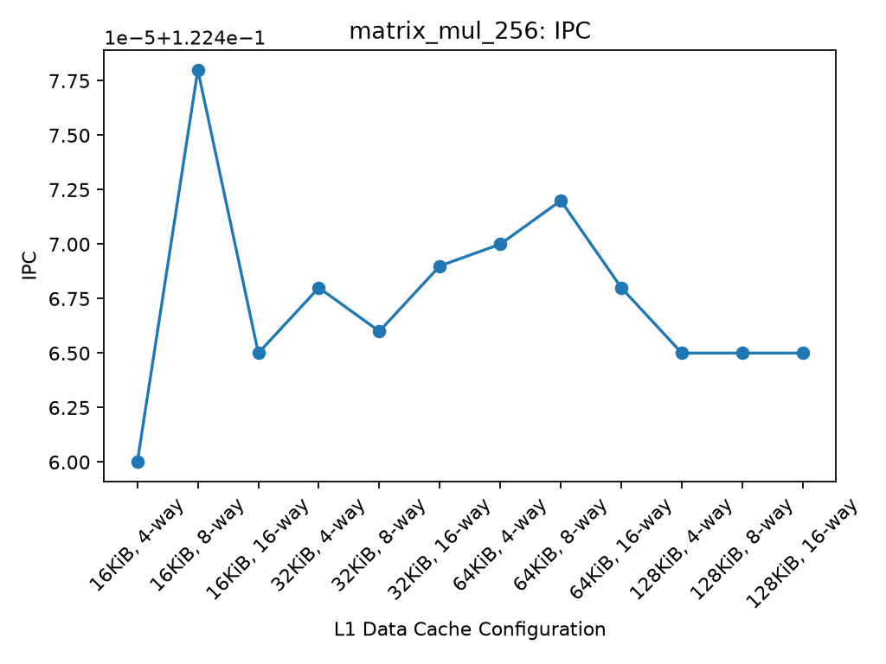 |
| L1D demand misses | 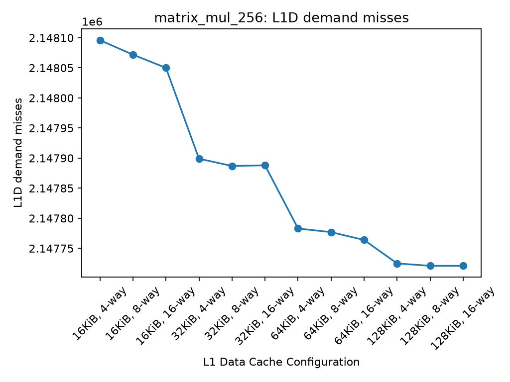 |
| Simulation ticks | 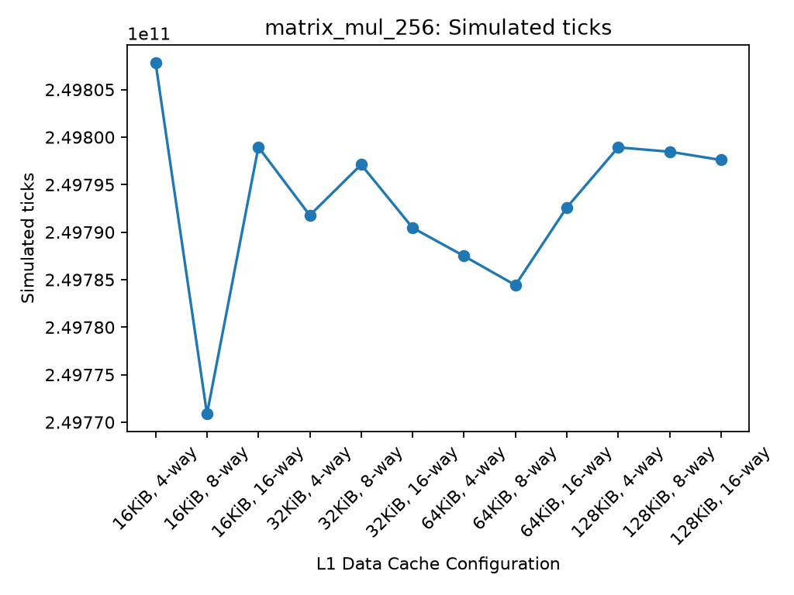 |

### Memory-Intensive Workload

| Metric | Plot |
|---|---|
| IPC | 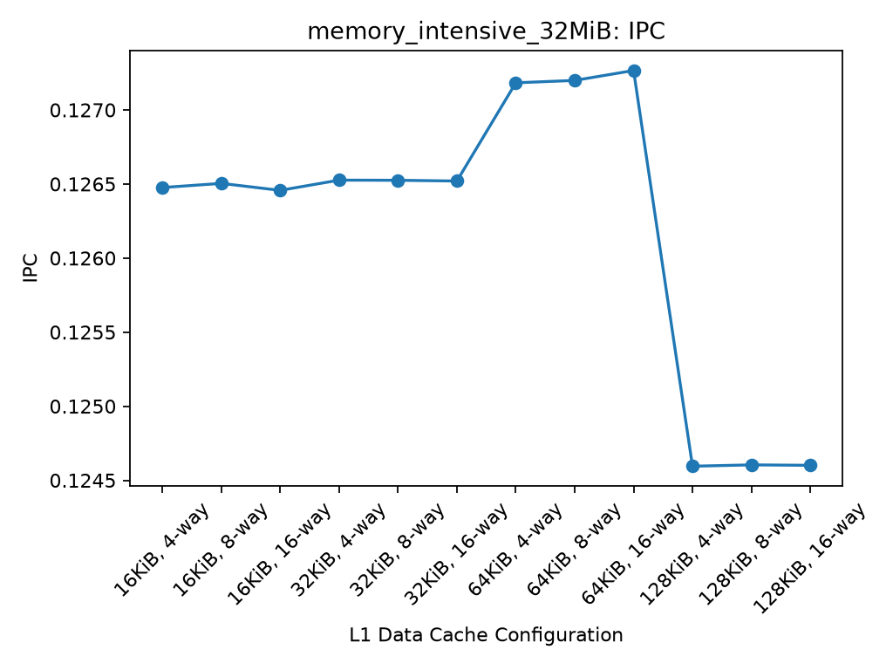 |
| L1D demand misses | 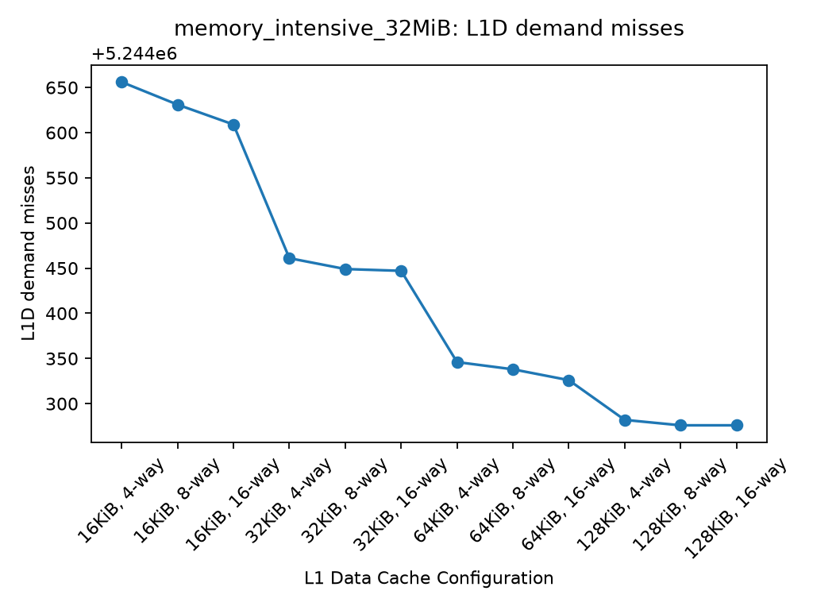 |
| Simulation ticks | 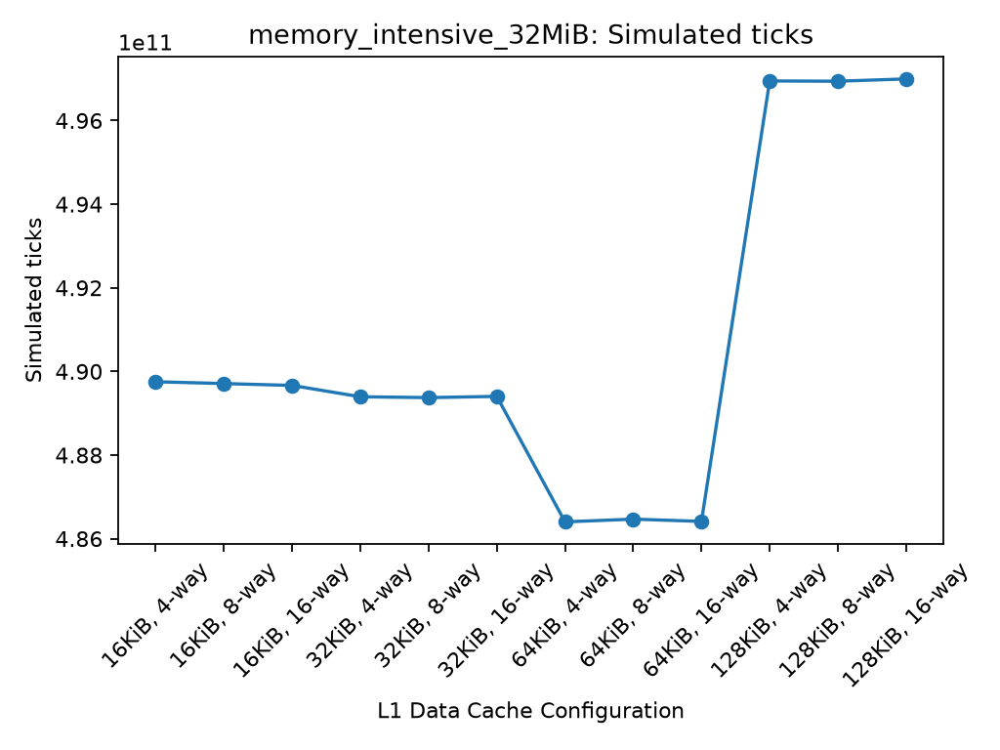 |

### Branch-Intensive Workload

| Metric | Plot |
|---|---|
| IPC | 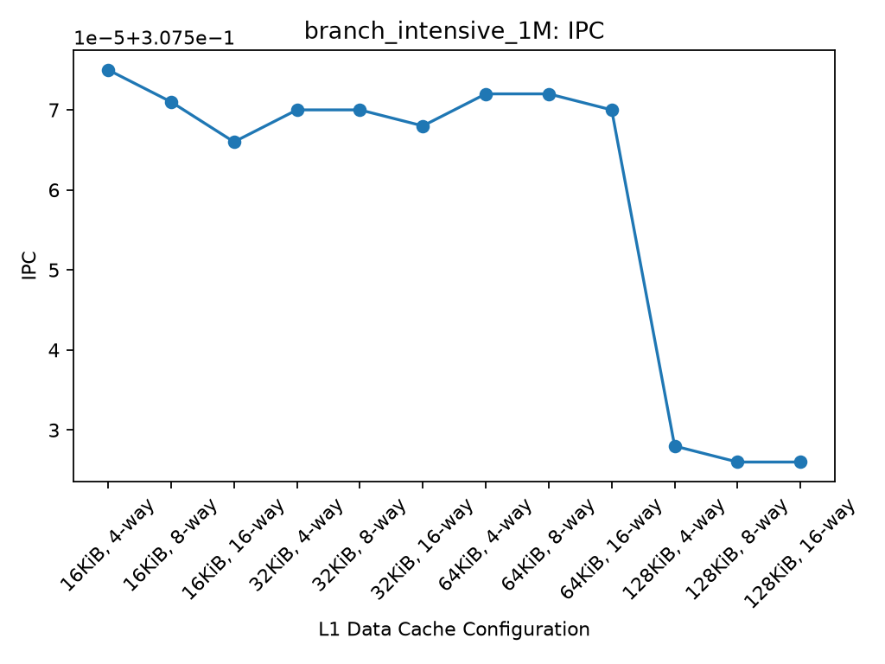 |
| L1D demand misses | 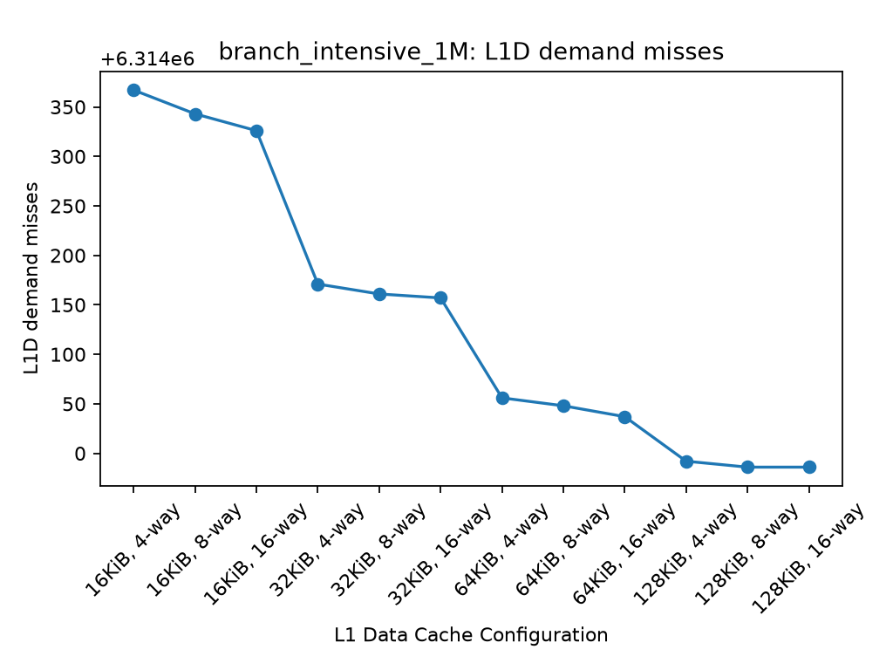 |
| Simulation ticks | 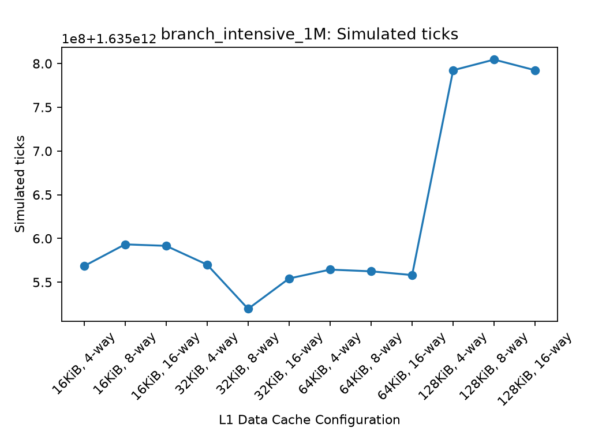 |

Additional branch-cache analysis plots are available in `plots/branch_cache/`.

## Repository Structure

```text
workload-cache-project/
├── configs/
│   └── x86_cache.py
├── workloads/
│   ├── matrix_mul.c
│   ├── memory_intensive.c
│   └── branch_intensive.c
├── scripts/
│   ├── run_cache_sweep.py
│   ├── run_memory_sweep.py
│   ├── run_branch_sweep.py
│   ├── combine_datasets.py
│   ├── validate_dataset.py
│   ├── extract_workload_features.py
│   ├── classify_workloads.py
│   ├── analyze_cache_results.py
│   ├── recommend_cache.py
│   ├── plot_results.py
│   └── plot_branch_results.py
├── data/
│   ├── cache_sweep.csv
│   ├── memory_cache_sweep.csv
│   ├── branch_cache_sweep.csv
│   ├── combined_cache_dataset.csv
│   ├── best_worst_configurations.csv
│   ├── cross_workload_summary.csv
│   ├── workload_features.csv
│   ├── workload_features_by_config.csv
│   └── workload_classification.csv
├── plots/
├── reports/
│   ├── cache_analysis_report.md
│   └── final_report.md
├── results/
│   ├── raw/
│   └── processed/
│       └── cache_recommendations.csv
├── requirements.txt
├── .gitignore
└── README.md
```

## Reproducibility and Setup

### Requirements

- Python 3.10 or newer.
- pip.
- GCC or another compatible C compiler to rebuild the workloads.
- An X86 build of gem5 to rerun simulations.
- Python dependencies listed in `requirements.txt`.

The analysis and plotting scripts can process existing datasets without rerunning gem5, provided the required datasets and simulation statistics are available.

### Python Environment

Create and activate a virtual environment from the repository root:

```bash
python3 -m venv .venv
source .venv/bin/activate
python -m pip install -r requirements.txt
```

### Reproduce Analysis and Visualizations

With the virtual environment activated, run:

```bash
python scripts/combine_datasets.py
python scripts/extract_workload_features.py
python scripts/classify_workloads.py
python scripts/analyze_cache_results.py
python scripts/recommend_cache.py
python scripts/plot_results.py
python scripts/plot_branch_results.py
```

These scripts combine the workload datasets, extract workload features, generate benchmark-defined classifications, produce configuration rankings and recommendations, update the analysis report, and generate visualizations.

Review generated changes before committing them.

**Note:** `extract_workload_features.py` requires the existing gem5 statistics files under `results/raw/`. If those files are unavailable, feature extraction cannot be reproduced from the CSV datasets alone.

### Rerun Simulations

The following scripts execute gem5 simulations and can take considerably longer than the analysis scripts:

```bash
python scripts/run_cache_sweep.py
python scripts/run_memory_sweep.py
python scripts/run_branch_sweep.py
```

Before running them, ensure that the gem5 X86 binary and compiled workload executables are available.

The sweep scripts validate simulation results before replacing the official workload CSV files. Review the resulting dataset changes before committing them.

### Generated Analysis Outputs

The workload-analysis pipeline produces the following files:

| Output | Description |
|---|---|
| `data/workload_features_by_config.csv` | Extracted features for each of the 36 workload/configuration combinations |
| `data/workload_features.csv` | Median feature summary for each workload |
| `data/workload_classification.csv` | Benchmark-defined workload categories and explanations |
| `data/best_worst_configurations.csv` | Fastest and slowest observed configurations |
| `reports/cache_analysis_report.md` | Generated cache analysis report |
| `results/processed/cache_recommendations.csv` | Recommended configurations, MPKI metrics, and baseline comparisons |

The recommendation pipeline selects the configuration with minimum observed simulated ticks. The baseline is a 32 KiB, 8-way L1D cache.

Simulated ticks are simulation metrics, not measured wall-clock execution time. The results have not established statistical significance for small performance differences. The experiments do not measure power consumption or physical cache area.

## Additional Experiment: Cache-Capacity Analysis and Held-Out Validation

This experiment evaluates workload classification and cache-configuration recommendations using gem5.

### Held-Out Results

| Metric | Result |
|---|---:|
| Classification accuracy | 4/4 (100%) |
| Recommendations passing the 95% baseline threshold | 3/4 (75%) |
| Main failure case | hashchain |

The hashchain recommendation achieved approximately 0.5744x baseline performance. This demonstrates that correct workload classification does not guarantee a successful cache recommendation.

See [the held-out experiment report](reports/holdout_cache_capacity_report.md) for methodology, results, limitations, and future work.

### Visualizations

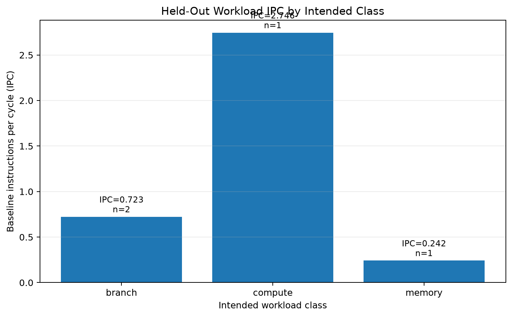

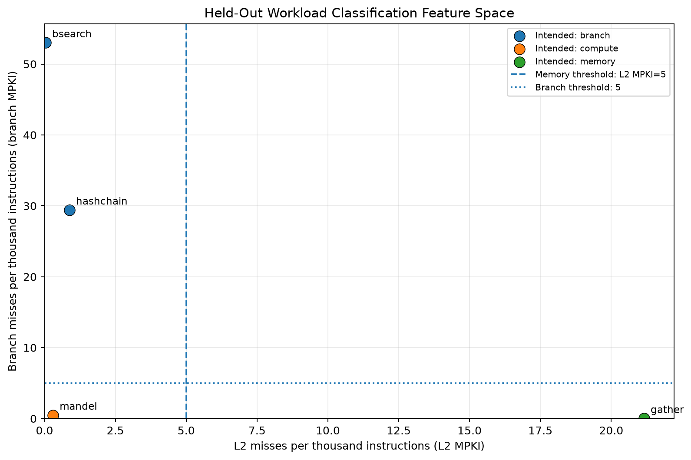

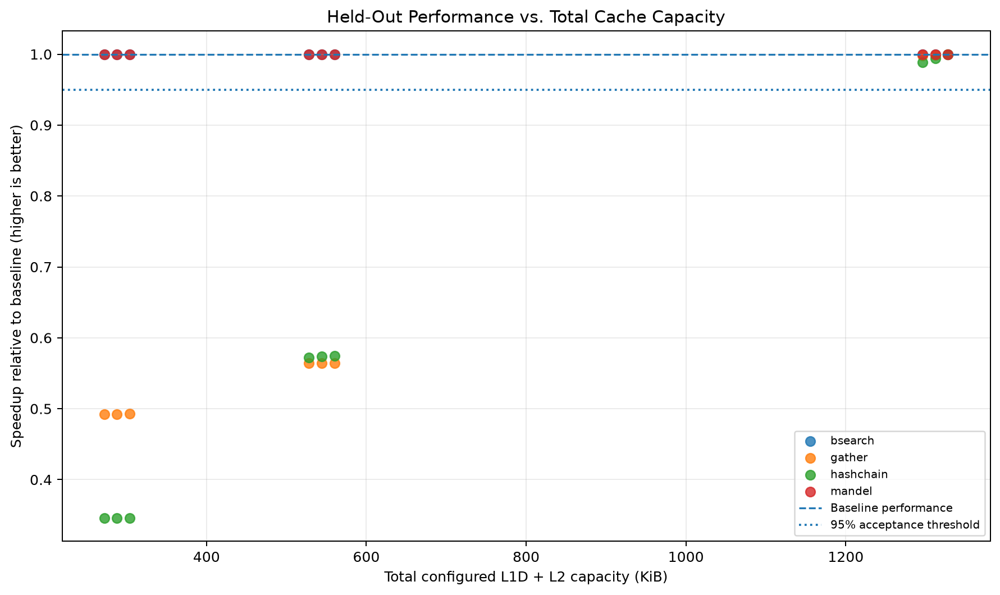

### Regenerate Visualizations

Activate the virtual environment and run `python scripts/plot_holdout_results.py`. This regenerates the figures from existing CSV files without rerunning gem5 simulations.


## Phase 2 Layout and Reproduction (workload-aware recommendation)

```text
configs/x86_cache_v2.py          O3/Timing CPU, optional L2, block size, branch predictor
workloads/kernels.c              12 training kernels (-DK_<NAME>)
workloads/kernels_holdout.c      4 held-out kernels (-DH_<NAME>)
scripts/build_workloads.sh, build_holdout.sh
scripts/run_baseline.sh          12 workloads on the baseline config
scripts/extract_features_v2.py   features -> data/o3_features.csv
scripts/classify_v2.py           rule + decision tree -> data/o3_classification.csv
scripts/run_sweep.sh             8 more configs x 12 workloads (baseline reused)
scripts/analyze_sweep.py         per-class speedups and recommendations
scripts/run_holdout_sweep.sh     4 held-out kernels x 9 configs
scripts/validate_holdout.py      held-out validation -> data/holdout_validation.csv
scripts/run_controlled_hashchain.sh   hashchain L2-capacity experiment
scripts/plot_training_sweep.py, plot_holdout_results.py   figures
```

Phase 1 files (`classify_workloads.py`, `recommend_cache.py`, `data/workload_classification.csv`, `results/processed/`) belong to the earlier L1D-only study; Phase 2 uses the `_v2` and `o3_*` files.

```bash
source .venv/bin/activate
./scripts/build_workloads.sh && ./scripts/build_holdout.sh
./scripts/run_baseline.sh && python scripts/extract_features_v2.py
python scripts/classify_v2.py
./scripts/run_sweep.sh && python scripts/analyze_sweep.py
./scripts/run_holdout_sweep.sh && python scripts/validate_holdout.py
python scripts/plot_training_sweep.py && python scripts/plot_holdout_results.py
```

gem5 raw `stats.txt` files are large and not tracked. The committed CSVs in `data/` (`o3_features.csv`, `sweep_results.csv`, `holdout_sweep_results.csv`) hold every extracted value, so classification, recommendation tables, and figures can be regenerated without rerunning gem5. Rerunning the simulations needs gem5 v25.1.0.1 built for X86 at `~/projects/gem5/build/X86/gem5.opt`.
